<a href="https://kursatsahin.vercel.app"></a>



<a href="https://github.com/kursadsahin0?tab=repositories"></a>
<a href="https://kursatsahin.vercel.app"></a>
<a href="https://github.com/kursadsahin0"></a>

<a href="https://menumgo.netlify.app"></a>
<a href="https://kpssharitasi.com.tr"></a>
<a href="https://cryptpulsee.netlify.app"></a>
<a href="https://codednas.netlify.app"></a>
<a href="https://park-kasa.vercel.app"></a>
<a href="https://yesilbakery.netlify.app"></a>


<a href="https://kursatsahin.vercel.app">Portfolio</a> ·
<a href="https://www.linkedin.com/in/kursat-sahin0">LinkedIn</a> ·
<a href="https://github.com/kursadsahin0/menumGo">menümGo</a> ·
<a href="https://github.com/kursadsahin0/kpssharitasi">KPSS Haritası</a> ·
<a href="https://github.com/kursadsahin0/cryptoPulse">CryptoPulse</a> ·
<a href="https://github.com/kursadsahin0/codeDNA">CodeDNA</a>

Cards are animated SVGs drawn by <a href="./scripts/render_cards.py">scripts/render_cards.py</a> and refreshed every morning by a GitHub Action.
